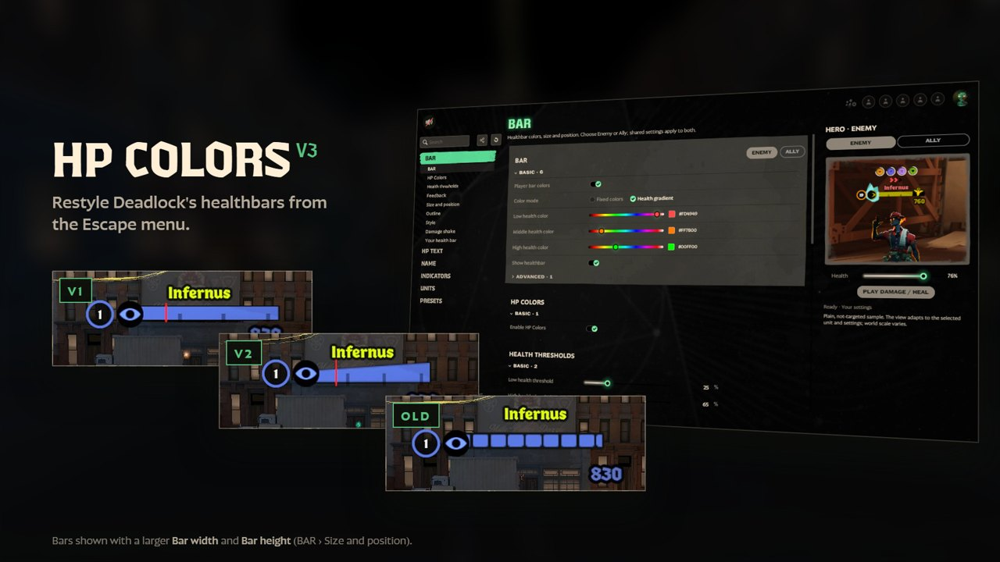
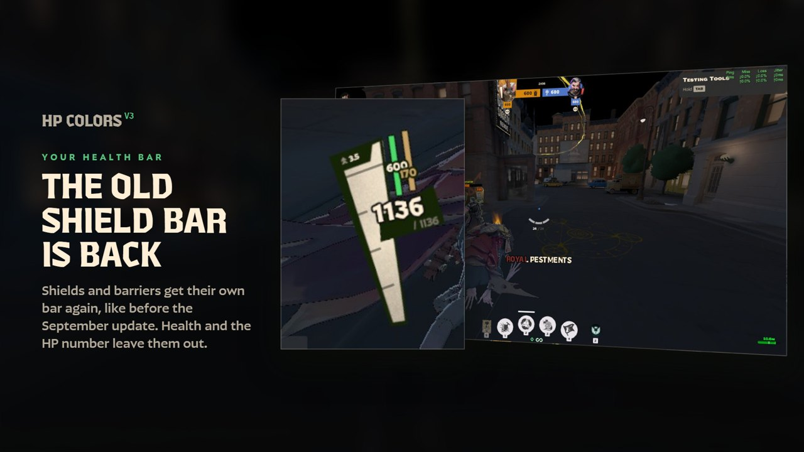
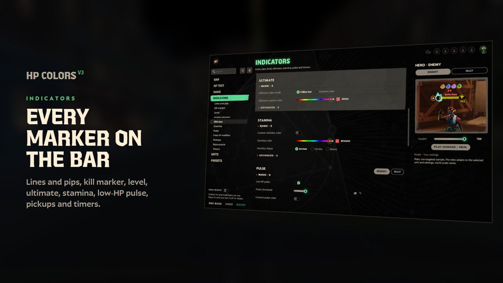
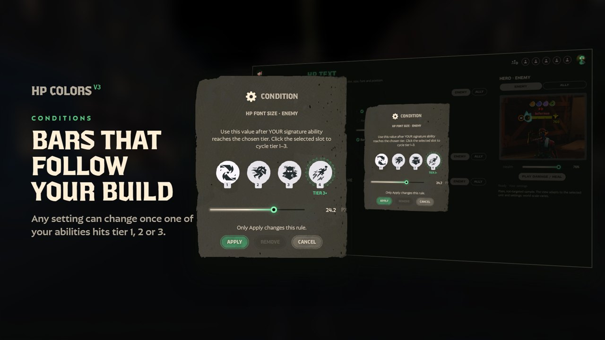
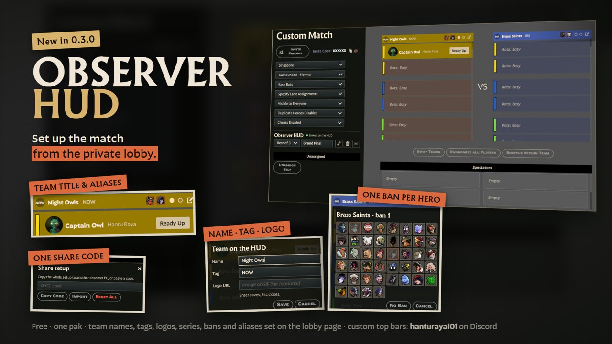
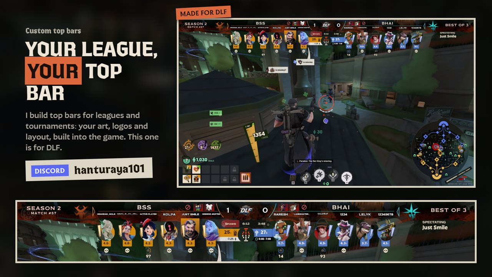
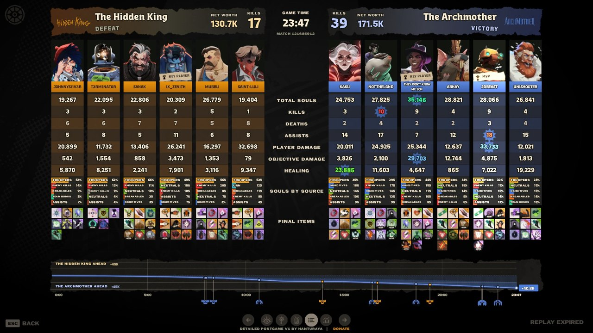
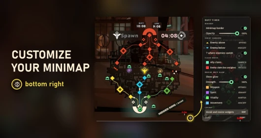

# Deadlock Mods Collection


Source for my Deadlock UI mods. Each mod is a folder of Panorama layouts, scripts and styles that compiles into one `pakNN_dir.vpk` for the game's `addons` folder.

Most players should download the released builds from GameBanana instead of building from source.

## Showcase

### HP Colors v3

Restyle Deadlock's health bars from the Escape menu: colors per side, shield bar, HP number, markers, timers, presets and share codes. [Download on GameBanana](https://gamebanana.com/mods/603113).

 
 

### Observer HUD

A spectator HUD for community tournaments: two top bar looks, team names, logos, series score, bans and a private-lobby setup page. [Download on GameBanana](https://gamebanana.com/mods/731315).

 

### Detailed Postgame

A stats board on the post-game scoreboard: exact numbers per player, souls by source, final items and graphs.



### Buff Timer

Customize the minimap: rift and urn timers, mid boss timer, enemy markers and buff colors, with a settings panel at the bottom right.



### Passive Items and Actives Icons

Always shows passive items and active icons on the HUD. [Download on GameBanana](https://gamebanana.com/mods/601444).


## Mods

### Maintained

| Mod | Folder | What it does |
|---|---|---|
| HP Colors v3 | [`hp_colors_rewrite_v3`](hp_colors_rewrite_v3) | Health bar editor. Variants for QOLLOCK ([`_qollock`](hp_colors_rewrite_v3_qollock)) and ShowRank ([`_showrank`](hp_colors_rewrite_v3_showrank)). |
| Observer HUD | [`observer_hud`](observer_hud) | Tournament spectator HUD with an Escape-menu editor and lobby setup. |
| DLF Observer | [`dlf`](dlf) | Spectator HUD and broadcast banner for the DLF league. |
| Detailed Postgame | [`detailed_postgame`](detailed_postgame) | Post-game stats board. |
| Buff Timer | [`buff_timer_virgin`](buff_timer_virgin) | Minimap timers (rift, urn, mid boss), enemy markers and buff colors, with a settings panel. |
| ShowRank Barebones | [`showrank_barebones`](showrank_barebones) | Predicted rank on profile cards, the top bar and Escape player rows. |
| Show Rank Merger | [`Show-rank-merger`](Show-rank-merger) | Browser app that merges two GameBanana downloads into one VPK. |
| Feeder Feed | [`feeder_feed`](feeder_feed) | A tab in the damage report that ranks who fed souls to the other team. |
| Mercurial Magnum Notifier | [`mercurial_magnum_notifier`](mercurial_magnum_notifier) | Item-state indicators beside the ammo count. |
| Passive Items and Actives Icons | [`abilities`](abilities) | Always shows passive items and active icons ([GameBanana](https://gamebanana.com/mods/601444)). |
| Old Main Menu | [`old_main_menu`](old_main_menu) | The July 2025 main menu on the current client. |
| Profile Stats | [`profile_stats_community`](profile_stats_community) | Community stats on the profile page. |
| FPS configs | [`fps`](fps) | FPS optimization configs and the benchmarks behind them. |

### Deprecated

These have not been updated for months and may not work on the current game build. The source stays here for reference.

| Mod | Folder | Last change |
|---|---|---|
| HP Colors v2 and v1 | `hp_colors_rewrite_v2*`, `hp_colors_rewrite`, `hp_colors*` | Oct 2026 (replaced by v3) |
| Recent Purchase | `recent_purchase` | Oct 2026 |
| Soul Timer, Jungle Timer, Combined Timer | `soul_timer`, `jungle_timer`, `combined_timer_v2` | Aug 2026 |
| Better Map, old color blind | `bettermapmod`, `old_color_blind` | Aug 2026 |
| Self HP, Shiv sound | `self_hp`, `hp`, `shiv` | May 2026 |
| Early experiments | `radar`, `event*`, `apis`, `api_test`, `obj_damage_top_bar`, `post`, `legacytarget` | Jan 2026 or earlier |

<details>
<summary>Old screenshots (deprecated mods)</summary>

**Recent Purchase (deprecated)**


**Soul Timer (deprecated)**


**Self HP (deprecated)**


**Shiv Neon Prime sound (deprecated)**

[](http://www.youtube.com/watch?v=o2YOa693yLQ)

</details>

## Install

1. Open your Deadlock folder, usually `C:\Program Files (x86)\Steam\steamapps\common\Deadlock\game\citadel`.
2. Open `gameinfo.gi` in a text editor and find `SearchPaths`.
3. Add `Game citadel/addons` above the `Game citadel` line:

    ```text
    SearchPaths
    {
        Game citadel/addons
        Game citadel
        Game core
        ...
    }
    ```

4. Put the mod's `pakNN_dir.vpk` in `game\citadel\addons` (create the folder if it is missing) and restart the game.

## Build from source

The repository holds raw source; the game loads compiled files only.

- **HP Colors v3:** needs Node.js. Run `node hp_colors_rewrite_v3/tools/doctor.js` to check the toolchain, then `node hp_colors_rewrite_v3/tools/build.js --project v3|qollock|showrank|all --skip-deploy`. See [`hp_colors_rewrite_v3/AGENTS.md`](hp_colors_rewrite_v3/AGENTS.md).
- **Other mods:** run the matching `build_<mod>.ps1` in the repository root. Each mod's `AGENTS.md` lists its checks.

Builds never write to the game folder; copy the resulting VPK yourself.

## License

Unless otherwise noted, original code and original mod source in this repository are licensed under the Apache License, Version 2.0. See [LICENSE](LICENSE).

Attribution notices for this project are included in [NOTICE](NOTICE). If you distribute this software or derivative works, preserve the applicable copyright, license, and notice files as required by Apache-2.0. This project was created by Hantu-Raya.

### Third-party and game materials

Deadlock, Source 2, Valve, Panorama, and related names, paths, formats, trademarks, and game assets belong to their respective owners. This project is an unofficial fan modification and is not affiliated with Valve.
