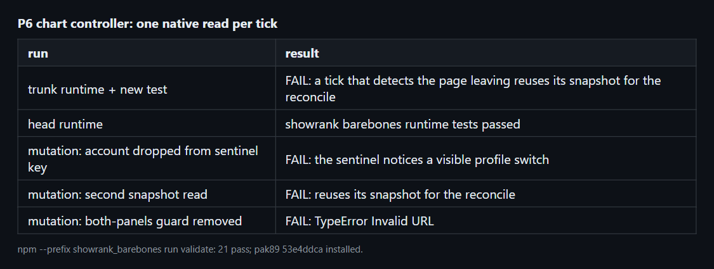

# refactor(showrank-barebones): read chart signals once per tick (P6)

Commit `e5eb3e4` in `Deadlock-mods-collection`. The feature base is `7b0b4f6`.

## Summary

```diff
 tick()
-  idle: profileChartsSignal()            read PageVisible, async state, account
-  reconcileProfileCharts()               read them again
-  idleSignal = profileChartsSignal()     read them a third time
+  snapshot = readProfileSnapshot()       read each once
+  idle: compare profileSnapshotKey(snapshot)
+  reconcileProfileCharts(snapshot)
+  idleSignal = profileSnapshotKey(snapshot)
```

## Evidence

- **Before:** the trunk runtime fails the new test with "a tick that detects the page leaving reuses its snapshot for the reconcile".
  **After:** the head runtime passes, and `npm --prefix showrank_barebones run validate` passes 21 tests.



- Three mutations each fail the tests: the account dropped from the key, a second read, and the both-panels guard removed.
- pak89 `53e4ddca` is built and installed. The in-game check is pending your go.

## Merge Danger

**Door:** two-way

The change is local to the profile chart controller.

**Blast Radius:** profile

A wrong snapshot would show stale charts. The visible-switch and return-by-keyboard tests cover that case.
